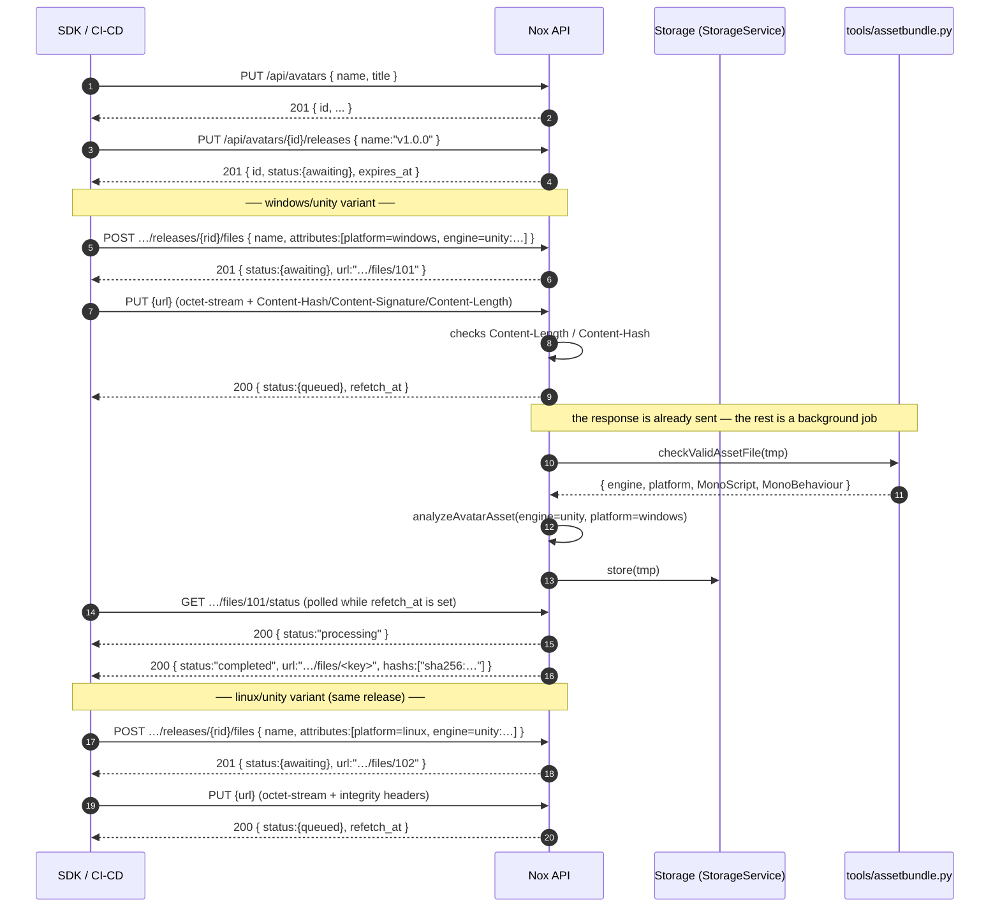

# Upload pipeline (SDK / CI-CD)

This document describes a **sample** upload pipeline for an **avatar** with two variants:

- `windows` / `unity`
- `linux` / `unity`

It relies on the generic upload provider (`UploadProvider`, `id = upload`) and the routes
exposed by `AssetControllerBase`.

> ⚠️ **Current state**: the upload provider is wired to the `mod` type (endpoint `mods`).
> Types are declared with `@AssetController(type, endpoint)`. To use the same pipeline with
> `avatar`, register the `avatar` type on an `AssetsModule`
> (`AssetsModule.register({ providers: [UploadProvider], ... })`) with an
> `@AssetController('avatar', 'avatars')` controller. The routes below are therefore written
> generically (`{type}` / `{endpoint}`) and then illustrated with `avatar`.

---

## 1. Overview

| Step | Method | Route | Purpose |
|------|--------|-------|---------|
| 1 | `PUT` | `/api/{endpoint}` | Create the asset (avatar) |
| 2 | `PUT` | `/api/{endpoint}/{id}/releases` | Create the release (version) |
| 3 | `POST` | `/api/{endpoint}/{id}/releases/{releaseId}/files` | Reserve a file slot → upload URL |
| 4 | `PUT` | `/api/{endpoint}/{id}/releases/{releaseId}/files/{fileId}` | Send the raw bytes → analysis + validation + automatic `completed` |

Steps 3→4 are repeated **for each variant** (windows, linux). The URL returned at step 3 is
passed back as-is at step 4, with the **same** `Authorization` header (there is no token in
the URL anymore).

### Other operations

| Method | Route | Purpose |
|--------|-------|---------|
| `GET` | `/api/{endpoint}` | Search the assets — only those owning a completed release (see §5) |
| `GET` | `/api/{endpoint}/{id}/releases` | List the releases (paginated, `total`) — newest first, completed ones only by default |
| `GET` | `/api/{endpoint}/{id}/releases/{version}` | One release — **without** its files |
| `GET` | `/api/{endpoint}/{id}/releases/{version}/files` | List the files of a release (paginated, `query` + attribute filters, `total`) — completed ones only by default |
| `GET` | `/api/{endpoint}/{id}/releases/{releaseId}/files/{fileRef}/status` | Check a file slot status, by numeric id or file name (no bytes streamed) |
| `PATCH` | `/api/{endpoint}/{id}` | Update asset metadata / preferred release |
| `PATCH` | `/api/{endpoint}/{id}/releases/{version}` | Update release metadata (files are immutable) |
| `DELETE` | see §11 | Delete an asset, a release or a file (cascading) |

Every route accepts `?full=1` (writes included) to get the **expanded** representation:
`url` becomes `{ proxified, original }` and the asset's `release` becomes
`{ auto, value }`. Without it, `url` is a plain string and `release` a bare id.

Every listing also accepts `?status=` — cumulative, `all` for everything — to include the
resources that are not completed yet (§5).

### Diagram



---

## 2. Prerequisites

- **Response envelope**: every successful response is wrapped by `ApiInterceptor` as
  `{ data, request, time }`; errors use `{ data: null, error: { code, message, status }, request, time }`.
  The JSON excerpts in this document show the `data` part only.
- **Auth**: `Authorization: Bearer <token>` (valid session).
- **Creating the asset** (`PUT /api/{endpoint}`): `can_file_upload` tag (`sys:` / `adm:` / `dft:`) **or** admin.
- **Release, slot, upload, deletion, images**: restricted to the asset **owner**, its
  **contributors** or an **admin**.
- The target type must be declared with `@AssetController(type, endpoint)` **and** covered by
  `UploadProvider` (see the warning above).
- Uploaded files are **Unity bundles**: they are analyzed **after** the `PUT` answered (background
  job on the `asset-upload` queue) by `checkValidAssetFile()` (through `tools/assetbundle.py`),
  then validated by the type validator (`analyzeAvatarAsset` for `avatar`). The slot reports
  `awaiting` (no bytes yet) → `queued` (bytes received, waiting for the validation) →
  `processing` → `completed` (or `failed`) and the client polls it (§7).

```bash
export API="https://nox.example.com/api"
export TYPE="avatar"          # or "mod"
export EP="avatars"           # endpoint associated with the type
export TOKEN="<session-token>"
```

---

## 3. Detailed pipeline (avatar example)

### Step 1 — Create the asset

```bash
curl -sS -X PUT "$API/$EP" \
  -H "Authorization: Bearer $TOKEN" \
  -H "Content-Type: application/json" \
  -d '{
    "name": "my-avatar",
    "title": "My Avatar",
    "description": "Demo avatar",
    "tags": ["usr:demo"]
  }'
```

Response (excerpt):

```json
{ "id": 42, "name": "my-avatar", "title": "My Avatar", "release": -1 }
```

> `id` and `name` are optional: a custom `id` can be provided (`"id": 42`). Without a `name`,
> the asset can only be addressed by its id.
>
> `name` is an **identifier**: it must start with an alphanumeric character and may then contain
> letters, digits, dots, underscores and dashes (`^[a-zA-Z0-9][a-zA-Z0-9._-]*$`, max 64 chars), so
> it stays URL-safe and usable in the `nid` alias (`name@server`). Renaming it is possible through
> `PATCH /api/{endpoint}/{id}` (§8).

### Step 2 — Create the release (`v1.0.0`)

```bash
curl -sS -X PUT "$API/$EP/42/releases" \
  -H "Authorization: Bearer $TOKEN" \
  -H "Content-Type: application/json" \
  -d '{ "name": "v1.0.0", "title": "Initial release", "channel": "stable" }'
```

Response (excerpt):

```json
{
  "id": 7,
  "name": "v1.0.0",
  "status": { "status": "awaiting", "progress": null, "message": "Waiting for the first file" },
  "expires_at": 1789340000000
}
```

> The release **does not embed its files** — a release can hold a very large number of them, so
> they are paginated through `GET /api/{endpoint}/{id}/releases/{version}/files` (see §1).

> A release with **no completed file yet** is `awaiting` and carries an `expires_at`. Both are
> resolved as soon as one of its files is uploaded: the release becomes `completed` and the
> expiration is removed.

### Steps 3 → 4 — **windows / unity** variant

**3. Reserve the slot**

```bash
curl -sS -X POST "$API/$EP/42/releases/7/files" \
  -H "Authorization: Bearer $TOKEN" \
  -H "Content-Type: application/json" \
  -d '{
    "name": "my-avatar-windows.bundle",
    "mime": "application/octet-stream",
    "attributes": [
      { "key": "platform", "value": "windows" },
      { "key": "arch",     "value": "x86_64" },
      { "key": "engine",   "value": "unity:6000.4" }
    ]
  }'
```

Response (excerpt):

```json
{
  "name": "my-avatar-windows.bundle",
  "status": { "status": "awaiting", "progress": null, "message": "Waiting for the file bytes" },
  "url": "https://nox.example.com/api/avatars/42/releases/7/files/101",
  "expires_at": 1789340000000,
  "attributes": [
    { "key": "platform", "value": "windows" },
    { "key": "arch", "value": "x86_64" },
    { "key": "engine", "value": "unity:6000.4" }
  ]
}
```

**4. Send the binary** (raw bytes) with the optional integrity headers

```bash
BIN=./my-avatar-windows.bundle
HASH="sha256:$(sha256sum "$BIN" | cut -d' ' -f1)"

curl -sS -X PUT "$API/$EP/42/releases/7/files/101" \
  -H "Authorization: Bearer $TOKEN" \
  -H "Content-Type: application/octet-stream" \
  -H "Content-Hash: $HASH" \
  -H "Content-Length: $(stat -c%s "$BIN")" \
  -H "Content-Signature: ed25519:MEQCIG9X…" \
  --data-binary @"$BIN"
```

At this point the server, **in a single request**:

1. streams the body to a temporary file (SHA-256 hash + size computed),
2. checks `Content-Length` and `Content-Hash` when provided,
3. runs `checkValidAssetFile()` (bundle analysis),
4. runs the `avatar` validator (engine `unity`, expected platform, `AvatarDescriptor`),
5. stores the file and marks it **`completed`**: `hash`/`size` are set automatically and
   `Content-Signature` is kept.

> The three headers are **optional**: `Content-Length`/`Content-Hash` are only integrity
> checks, `Content-Signature` is merely recorded.

Response (excerpt):

```json
{
  "id": 101,
  "name": "my-avatar-windows.bundle",
  "status": "completed",
  "url": "https://nox.example.com/api/files/<key>",
  "size": 12345678,
  "mime": "application/octet-stream",
  "hashs": ["sha256:…"],
  "analysis": { "engine": "unity", "platform": "windows", "version": null, "descriptors": 1 }
}
```

> Once `completed`, the file **no longer has an `expires_at` field** (it is omitted, not `null`).

### Steps 3 → 4 — **linux / unity** variant

Same calls, changing `name` and the `platform` attribute:

```bash
curl -sS -X POST "$API/$EP/42/releases/7/files" \
  -H "Authorization: Bearer $TOKEN" \
  -H "Content-Type: application/json" \
  -d '{
    "name": "my-avatar-linux.bundle",
    "mime": "application/octet-stream",
    "attributes": [
      { "key": "platform", "value": "linux" },
      { "key": "arch",     "value": "x86_64" },
      { "key": "engine",   "value": "unity:6000.4" }
    ]
  }'
# → { "url": "…/files/102", "status": {"status":"awaiting",…} }

BIN=./my-avatar-linux.bundle
HASH="sha256:$(sha256sum "$BIN" | cut -d' ' -f1)"

curl -sS -X PUT "$API/$EP/42/releases/7/files/102" \
  -H "Authorization: Bearer $TOKEN" \
  -H "Content-Type: application/octet-stream" \
  -H "Content-Hash: $HASH" \
  -H "Content-Length: $(stat -c%s "$BIN")" \
  --data-binary @"$BIN"
# → { "status": { "status": "queued" }, "refetch_at": … }
# the analysis runs in the background: poll §7 until `refetch_at` disappears
```

### Verification

```bash
# Wait for the analysis of the file uploaded above
until [ -z "$(curl -sS "$API/$EP/42/releases/7/files/102/status" \
  -H "Authorization: Bearer $TOKEN" | jq -r '.data.refetch_at')" ]; do sleep 2; done

# The release is now complete and no longer has an expiration
curl -sS "$API/$EP/42/releases/7" -H "Authorization: Bearer $TOKEN"

# Its files (the release itself does not embed them)
curl -sS "$API/$EP/42/releases/7/files?limit=20&offset=0" -H "Authorization: Bearer $TOKEN"

# The asset's preferred release points to the latest release
curl -sS "$API/$EP/42" -H "Authorization: Bearer $TOKEN"

# Download (redirects to /api/files/<key>)
curl -sSL "$API/$EP/42/releases/7/files/my-avatar-windows.bundle" -o /dev/null
```

---

## 4. Attributes

Attributes are **free-form** (`{ key, value }[]`) — they are **not** Nox tags.
Recommended convention:

| key | value | example |
|-----|-------|---------|
| `platform` | `windows` \| `linux` \| `macos` \| `android` \| `ios` \| `visionos` | `windows` |
| `arch` | target architecture | `x86_64` |
| `engine` | `"<engine>[:<version>]"` | `unity:6000.4` |

Example file name: `my-avatar-<platform>.bundle` (Unity bundle).

The type validator receives `{ type, attributes }` (a `key → value` map) and reads what it
needs. For `avatar`/`world`, `platform` and `engine` are **required by the upload rules** (see
below): a slot that omits one of them is refused before any byte is sent, and the descriptor
comparison uses them.

These attributes are stored in the **`asset_files.attributes` column** (JSON, `[{ key, value }]`).

### Upload rules

What a release accepts is declared **per asset type**, in code
(`src/assets/upload/upload-rules.ts` → `registerUploadRules`), and enforced **by the server** — not
per release, and never exposed on the asset/release payloads.

| Rule | Meaning |
|------|---------|
| `required` | attribute keys **every** file of the release must declare |
| `unique` | attribute key groups whose **combination** must stay unique across the release |

The defaults:

| Type | Rules |
|------|-------|
| `mod` | `required: [platform, engine]`, `unique: [[platform, engine]]` |
| `avatar` | `required: [platform, engine]`, `unique: [[platform, engine]]` |
| `world` | `required: [platform, engine]`, `unique: [[platform, engine]]` |
| anything else | none — attributes are free |

so a mod, an avatar or a world ships **one bundle per platform+engine pair**:

```bash
# BOTH are refused with a 400, before any byte is uploaded
curl -X POST "…/files" -d '{ "name": "a.bundle" }'                      # missing platform, engine
curl -X POST "…/files" -d '{ "attributes": [{"key":"platform","value":"windows"},{"key":"engine","value":"unity"}] }'
#   → Release "v1.0.0" already has a file with platform=windows, engine=unity ("a.bundle")
```

Both checks run when the slot is **reserved** (`POST …/files`) and again when its bytes are
**stored** (`PUT …/files/{id}`), so a refused slot never reaches the analysis and cannot be
duplicated concurrently. Attributes are matched case-insensitively, and **in full**:
`unity:6000.5` and `unity:6000.4` are two different pairs, like two different platforms. A group is
only checked on files declaring **all** of its keys.

Clients discover the rules through the public instance config — `GET /configs`, `assets` — which
lists every asset kind served by the instance (its payload `type`, its Nox identifier `key`, the
`endpoint` that serves it) along with its `rules`:

```jsonc
{
  "support_passkey": true,
  "assets": [
    { "type": "mod",    "key": "m", "endpoint": "mods",    "rules": { "required": ["platform","engine"], "unique": [["platform","engine"]] } },
    { "type": "avatar", "key": "a", "endpoint": "avatars", "rules": { "required": ["platform","engine"], "unique": [["platform","engine"]] } },
    { "type": "world",  "key": "w", "endpoint": "worlds",  "rules": { "required": ["platform","engine"], "unique": [["platform","engine"]] } }
  ]
}
```

The list is built from the registered asset controllers (`@AssetController(type, endpoint, key)`),
so a kind that declares no rule simply reports `"rules": {}`.

The rules apply to **new uploads** only: files already stored are not re-checked.

In API responses, a file (`IApiFile`) **never has an `undefined` field**:

- `id` → always set (the numeric file id, also the last segment of the upload URL);
- `attributes`, `alias`, `hashs` → arrays (`[]` when absent);
- `name`, `analysis`, `signature` → `null` when absent;
- `created_at` / `updated_at` → always set (epoch ms);
- `expires_at` → present **only** while the slot is `awaiting` (no bytes received yet) or
  `failed` (the retry window); omitted for `queued`, `processing` and `completed`;
- `refetch_at` → epoch ms after which the SDK should GET the resource again, **omitted** when it
  is stable (see §7);
- `analysis` → result returned by the type validator of the file type, otherwise `null`; its
  content is analyzer-specific, so the API does not fix its keys.

`IApiRelease` follows the same rule and carries the same `refetch_at` hint, but it **never embeds
its files**: `GET /api/{endpoint}/{id}/releases/{version}/files` serves them page by page
(`query`, `limit`, `offset`, attribute filters and `total`), so a release holding a million files
never loads them all.

---

## 5. Status lifecycle

| Object | Status | When |
|--------|--------|------|
| file | `awaiting` | slot reserved (`POST …/files`), no bytes received yet |
| file | `queued` | bytes received, waiting for the background validation |
| file | `processing` | the uploaded bundle is being analyzed |
| file | `completed` | analysis finished, the bytes are stored (background job) |
| file | `failed` | integrity failure (`Content-Hash`/`Content-Length`) or validation failure (bundle/descriptor) |
| release | `awaiting` | created without any completed file (also gets an `expires_at`) |
| release | `completed` | as soon as one of its files is uploaded |
| release | `awaiting` again | when its **last** file is deleted (with a fresh `expires_at`) |

On failure, the file stays in its slot and **can be retried** until its expiration is reached
(re-`PUT` on the same `fileId`). Its `url` is still the **upload URL** while the slot is pending —
it only switches to the storage/download URL once the upload is completed.

### Filtering the listings by status

The listings are **read by consumers**: by default they only expose what is complete, so a
half-finished upload never shows up in an SDK or a public page.

| Route | Default | Filter |
|-------|---------|--------|
| `GET /api/{endpoint}` | assets owning **at least one completed release** | `?status=` |
| `GET /api/{endpoint}/{id}/releases` | only the **completed** releases | `?status=` |
| `GET /api/{endpoint}/{id}/releases/{version}/files` | only the **completed** files | `?status=` |

`status` is **cumulative**: repeat it to widen the selection, and pass `all` to see everything
(pending, failed, completed). An unknown value answers `400`.

```bash
# only the completed ones (the default)
curl "$API/$EP/42/releases"

# the releases still being uploaded
curl "$API/$EP/42/releases?status=awaiting"

# every release, whatever its status
curl "$API/$EP/42/releases?status=all"

# cumulative: a release that is awaiting or processing
curl "$API/$EP/42/releases?status=awaiting&status=processing"

# the files of a release, failures included
curl "$API/$EP/42/releases/7/files?status=failed&status=completed"
```

An asset with **no release at all** counts as `awaiting`: `?status=awaiting` (and `?status=all`)
returns it, but the default listing hides it until its first release holds a completed file.

> Providers that **mirror a remote source** (`github`) only ever expose published content, so
> everything they serve is `completed`; a filter excluding `completed` returns nothing there.

### Live progress from the analyzer

While a slot is `processing`, the analysis tool reports what it is doing through **directives**
written to its stdout, GitHub-Actions style:

| Directive | Effect on the slot |
|-----------|--------------------|
| `::progress::<current> <total> <message…>` | sets `status.progress` (`{ current, total }`) and `status.message`; a `total` of `0` means the remaining work is unknown (the slot keeps its previous progress), and the message is optional |
| `::message::<text>` | sets `status.message` (plain text, no progress) |
| `::error::<text>` | ends the analysis as `failed` (the tool also exits non-zero) |
| `::result::<json>` | the analysis result itself (never exposed as a message) |

```text
::progress::0 0 Loading bundle
::progress::0 227 Scanning 227 objects
::progress::45 227
::progress::227 227 Bundle analyzed
::result::{"name":"…","engine":"unity","platform":19,"data":{…}}
```

Any line that is not a directive is kept as a fallback payload, so an analyzer that only prints the
JSON still works. The directives are forwarded by
`checkValidAssetFile(path, { onEvent })` (`src/utils/assetbundle.ts`), which is also usable on its
own:

```bash
/opt/venv/bin/python3 tools/assetbundle.py /path/to/bundle | grep '^::progress::'
```

`UploadProvider` throttles the writes (one per 400 ms, keeping the **last** value) so a client
polling `GET …/files/{fileRef}/status` follows the analysis live:

```jsonc
{
  "status": {
    "status": "processing",
    "progress": { "current": 45, "total": 227 }, // or null while unknown
    "message": "Scanning 227 objects"
  },
  "refetch_at": 1789331800000
}
```

`progress` is either the steps counted by the analyzer (`{ current, total }`) or **`null` while they
cannot be estimated** (nothing counted yet, or a `::progress::x 0` line): clients should then show
an indeterminate progress instead of a bar.

---

## 6. Expiration

- **Only `awaiting` and `failed` resources expire**:
  - a file **slot** while it is `awaiting` (reserved, no bytes received yet);
  - a **release** while it is `awaiting` (no completed file yet);
  - a **failed** file, which keeps a retry window before its slot is cleaned up.
- Everything else (`queued`, `processing`, `completed`) has **no** `expires_at`: as soon as the
  bytes are received the slot stops having a deadline.
- Default duration: **24 h**, overridable through the `upload.expiration_ms` config key.
- The `PUT` removes the file's expiry and clears the release's, once the release holds at least
  one completed file.

> Expiration is currently **informative**: it is exposed by the API but not yet *enforced*
> (no `410 Gone` rejection and no cleanup job).

---

## 7. Checking the status

An upload slot can be inspected **without** downloading its bytes:

```bash
curl -sS "$API/$EP/42/releases/7/files/101/status" \
  -H "Authorization: Bearer $TOKEN"
```

Response (excerpt):

```json
{
  "id": 101,
  "name": "my-avatar-windows.bundle",
  "status": "completed",
  "url": "https://nox.example.com/api/files/<key>",
  "size": 12345678,
  "hashs": ["sha256:…"],
  "analysis": { "engine": "unity", "platform": "windows", "version": null, "descriptors": 1 }
}
```

The route takes either the numeric `fileId` (the one present in the upload URL returned by step 3)
or the file name, like the deletion route: a numeric reference is looked up by id first, then by
name. Every file object exposes that id as `id`, so a client never has to parse the upload URL.

### `refetch_at` — when to poll

Both `IApiFile` and `IApiRelease` expose **`refetch_at`** (epoch ms, optional — handled exactly
like `expires_at`):

- **omitted** → the resource is **stable**: stop polling;
- a timestamp → the resource is still changing (`awaiting` / `queued` / `processing`): GET it again
  at or after that time.

```jsonc
// slot reserved, no bytes yet → keep polling
{
  "status": { "status": "awaiting", "progress": null, "message": "Waiting for the file bytes" },
  "expires_at": 1789340000000,
  "refetch_at": 1789331800000
}

// uploaded, analyzed and validated → stable, both fields are omitted
{
  "status": "completed",
  "url": "https://nox.example.com/api/files/<key>"
}
```

While a resource is pending, `refetch_at` is `now + <upload.refetch_ms>` (default **5 s**, see
§10). A `failed` file counts as stable: it is not polled, it is retried explicitly with a new
`PUT`.

> A release is stable only when it is `completed` **and** none of its files is pending — i.e. once
the background analysis of its uploaded files is over.

```bash
# Poll a slot until it is no longer pending
until [ "$(curl -sS "$API/$EP/42/releases/7/files/101/status" \
  -H "Authorization: Bearer $TOKEN" | jq '.refetch_at')" = "null" ]; do sleep 2; done
```

---

## 8. Updating

Files are **immutable**: a file slot is either created (`POST` + `PUT`) or deleted — there is no
file update route. Asset and release **metadata** can be patched.

### Update an asset

```bash
curl -sS -X PATCH "$API/$EP/42" \
  -H "Authorization: Bearer $TOKEN" \
  -H "Content-Type: application/json" \
  -d '{
    "title": "My Avatar (stable)",
    "description": "Updated description",
    "tags": ["usr:demo", "usr:featured"]
  }'
```

| Field | Type | Effect |
|-------|------|--------|
| `name` | `string \| null` | Rename the identifier (`null` clears it). Must start with an alphanumeric character and only contain `[a-zA-Z0-9._-]`, unique for the type. |
| `title` | `string \| null` | Display title. |
| `description` | `string \| null` | Description (`null` clears it). |
| `tags` | `string[]` | Replaces the Nox tags (invalid ones are dropped). |
| `release` | `integer \| null` | **Preferred release**: pin it to a release id, or `null` to go back to `auto`. |

Omitted fields are left untouched; only the **owner**, a **contributor** or an **admin** can patch.
Add `?full=1` to get the expanded asset (`release` as `{ auto, value }`).

### Change the preferred release

The asset exposes `release` as an `IApiReleasePreference` — a bare number, or `{ auto, value }`
with `?full=1`:

```jsonc
// GET /api/{endpoint}/{id}?full=1
{
  "release": { "auto": false, "value": 7 }
}
```

```bash
# Pin release #7
curl -sS -X PATCH "$API/$EP/42" -H "Authorization: Bearer $TOKEN" \
  -H "Content-Type: application/json" -d '{ "release": 7 }'

# Back to auto (always the latest release)
curl -sS -X PATCH "$API/$EP/42" -H "Authorization: Bearer $TOKEN" \
  -H "Content-Type: application/json" -d '{ "release": null }'
```

`value` is always the release id clients should use: the pinned one when `auto` is false, the
newest one otherwise. Deleting the pinned release resets the preference to `auto`.

### Update a release

```bash
curl -sS -X PATCH "$API/$EP/42/releases/7" \
  -H "Authorization: Bearer $TOKEN" \
  -H "Content-Type: application/json" \
  -d '{ "title": "Initial release", "changelog": "## 1.0.0", "channel": "stable" }'
```

| Field | Type | Effect |
|-------|------|--------|
| `name` | `string \| null` | Rename the version (`null` clears it). Must stay unique within the asset. |
| `title` | `string \| null` | Display title. |
| `changelog` | `string \| null` | Changelog (`null` clears it). |
| `channel` | `stable \| candidate \| nightly` | Release channel. |

A release's **status and expiration are never edited directly**: they are derived from its files
(see §5).

---

## 9. Errors

| Code | Case |
|------|------|
| `400` | Invalid DTO, asset/release/file `id` or name already taken, file already uploaded, `Content-Hash`/`Content-Length` mismatch, bundle/descriptor validation failure, pinned release not belonging to the asset |
| `401` | No valid session |
| `403` | Not owner/contributor/admin (release, upload, deletion, images), or missing `can_file_upload` permission (asset creation) |
| `404` | Asset / release / file / image not found |
| `501` | Operation not supported by the provider (`github`: deletion, images) |
| `503` | Type without a registered upload provider |

Constraint examples:

- **Bundle**: `checkValidAssetFile` fails (not a bundle, invalid JSON, exit ≠ 0).
- **Avatar descriptor**: `No AvatarDescriptor found`, `Platform mismatch: bundle is "linux", asset expects "windows"`, `Engine mismatch`, `Unknown platform ID`.
- **Hash mismatch**: `Content-Hash` does not match the received content.
- **Upload rules**: `Missing required attributes "platform", "engine" — this release requires platform, engine`,
  `Release "v1.0.0" already has a file with platform=windows, engine=unity ("my-avatar-windows.bundle")`
  (see §4).
- **Length mismatch**: `Content-Length` does not match the received size.

---

## 10. Implementation notes

- The upload `PUT` requires **authentication**: only an asset **owner / contributor / admin**
  can send the bytes (there is no token in the URL anymore).
- The reservation DTO's `name` and `mime` are **optional**: the effective `mime` comes from the
  `Content-Type` header, and the name — when the slot has none — comes from the
  `Content-Disposition` header (`filename="…"` or `filename*=UTF-8''…`) sent with the upload.
  An explicit slot name always wins (and must stay unique within the release).
- The effective `mime` is, in order: the `Content-Type` header (`; …` parameters stripped), then
  the slot's `mime`, then `application/octet-stream`. Creating a slot without `mime` is therefore
  allowed: it stays `application/octet-stream` until the `PUT`.
- There is **no confirmation step**: the `PUT` stores the received bytes, checks the integrity
  headers, marks the slot `queued` (waiting for the validation) and returns. The bundle analysis,
  the type validation and the storage write then run in a background job (`asset-upload` queue,
  see §10) which flips the slot to `completed` (or `failed`) — nothing is written to the storage
  for a rejected bundle.
  `size` / `hashs` are computed server-side while the bytes are received; the `Content-Hash` /
  `Content-Length` headers (checked) and `Content-Signature` (kept) are optional, and an integrity
  mismatch is the only failure answered directly by the `PUT` (`400`).
- A release is `awaiting` while it has no completed file and becomes `completed` with its first
  uploaded file (its `expires_at` is removed at the same time). Deleting its last file puts it
  back to `awaiting` with a fresh `expires_at`.
- **Deleting a slot, a release or an asset cancels the running analysis**: the delete route aborts
  the job of this process (the analyzer process is killed at once) and the job never resurrects a
  deleted slot — the bytes it may already have written are deleted too. Jobs running in another
  process (`queue.provider: bullmq` worker) cannot be aborted from here: they re-check that their
  slot still exists before storing anything and before finalizing, so the outcome is the same,
  only the CPU of the current analysis is not saved.
- Files are **immutable**: there is no file update route. Asset and release metadata can be
  patched (`PATCH`, see §8) but files are only created or deleted.
- `refetch_at` (see §7) is `now + <upload.refetch_ms>` while a file or release is pending, and is
  **omitted** otherwise; the default delay is **5 s** (`5000`). Like `expires_at`, the field only
  exists in the response when it is meaningful.
- The file name is **unique per release**. Without a name, the file can still be reached through
  its upload URL, whose last segment is the numeric `fileId` — also exposed as `id` in every
  `IApiFile`.
- The upload is **asynchronous**: the `PUT` only receives and verifies the bytes (it answers in a
  few milliseconds whatever the bundle size), the analysis + storage run in a background job
  through `JobQueueService` (`queue.provider` config: `sync` by default, `bullmq` for a
  Redis-backed queue with retries).
- The detected analysis is kept in `metadata.analysis` server-side and exposed as-is in
  `IApiFile.analysis` (filled by the type validator of the file type; `null` when there is none) —
  its content is analyzer-specific.

---

## 11. Deletion

The upload provider supports deletion (owner, contributor or admin). Providers that mirror a
remote source (e.g. `github`) do not implement it → `501 Not Implemented`.

| Method | Route | Effect |
|--------|-------|--------|
| `DELETE` | `/api/{endpoint}/{id}` | Deletes the asset, its releases, their files **and its images** |
| `DELETE` | `/api/{endpoint}/{id}/releases/{version}` | Deletes a release and its files |
| `DELETE` | `/api/{endpoint}/{id}/releases/{version}/files/{fileRef}` | Deletes a file |

```bash
# Delete a file
curl -sS -X DELETE "$API/$EP/42/releases/7/files/my-avatar-windows.bundle" \
  -H "Authorization: Bearer $TOKEN"
# → { "success": true }

# Delete a release
curl -sS -X DELETE "$API/$EP/42/releases/7" -H "Authorization: Bearer $TOKEN"

# Delete the asset (and everything it contains)
curl -sS -X DELETE "$API/$EP/42" -H "Authorization: Bearer $TOKEN"
```

Notes:

- Deletion is **cascading**:
  - deleting an **asset** removes its releases, their files **and the asset images** (DB rows and
    stored files alike);
  - deleting a **release** removes its files (DB rows and stored files) and resets the asset's
    `release` preference to `auto` when it pointed to it;
  - deleting a **file** leaves the release `awaiting` again (with a fresh `expires_at`) when no file
    is left, and `completed` otherwise.
- Stored files are deleted on a best-effort basis (`StorageService.delete`).
- In the DB, `Asset → AssetRelease → AssetFile` cascade through `onDelete: Cascade`.
- `{version}` accepts the release `id` **or** its `name` (e.g. both `/releases/7` and
  `/releases/v1.0.0` work).
- `{fileRef}` accepts a numeric file **id** or a file **name** (a numeric value is looked up by id
  first, then by name) — the download route (`GET …/files/{fileRef}`) behaves the same — so an
  **unnamed** slot stays reachable through the URL returned at step 3.

---

## 12. Asset images

Uploaded as `multipart/form-data` (field `file`) and stored through the local storage.

| Method | Route | Effect |
|--------|-------|--------|
| `POST` | `/api/{endpoint}/{id}/images` | Adds an image to the asset |
| `DELETE` | `/api/{endpoint}/{id}/images/{index}` | Removes the image at the given index (0-based) |

```bash
# Add an image (returns the asset with its `images` array)
curl -sS -X POST "$API/$EP/42/images" \
  -H "Authorization: Bearer $TOKEN" \
  -F "file=@./cover.png"

# Remove the second image
curl -sS -X DELETE "$API/$EP/42/images/1" \
  -H "Authorization: Bearer $TOKEN"
```

Notes:

- MIME type check: `image/png|jpeg|jpg|gif|webp|avif`.
- Rights: owner / contributor / admin.
- Image references are stored in the **`assets.images` column** (`[{ key, priority, alt }]`),
  no longer in `metadata`.
- The **file metadata** (dimensions, format) is **persisted by the storage** next to the file
  (sidecar `<id>.meta.json` for `LocalFileProvider`) and read back during sanitization.
- Images are exposed in `images[]` (`url`, `priority`, `width`, `height`, `alt`); the storage
  `key` is used to delete the file when the image is removed.
- Deleting the asset also deletes its stored images (cascade).
- `GithubProvider` does not support these routes → `501 Not Implemented`.
